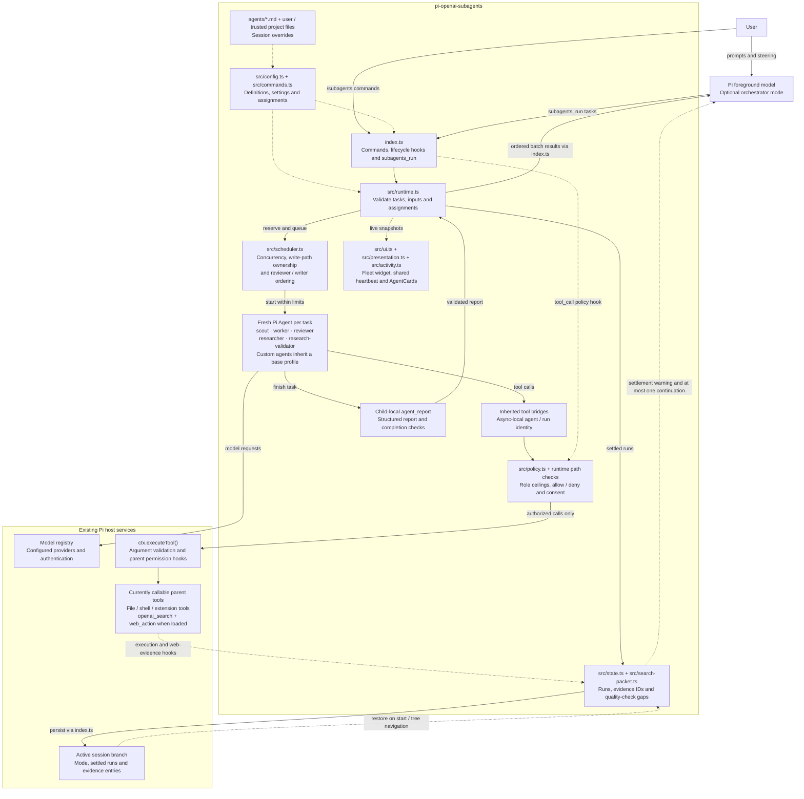

# pi-openai-subagents

Minimal OpenAI-first subagents for **Pi 1.0.0** and **Node ≥22.19.0**. The orchestrator is your
normal foreground, promptable model—not a scripted workflow engine. Five specialist roles run fresh
in-memory conversations through Pi's public `Agent` API. Custom agents are supported.

## Architecture

The foreground model decides when and how to delegate; the extension supplies configuration, policy
enforcement, bounded execution and result tracking. Specialists have separate in-memory
conversations, but execute inherited tools in the same Pi session and workspace.



Solid arrows show calls and result flow; dashed arrows show configuration, hooks, persistence
restoration and live updates.

- **Control:** `index.ts` connects Pi commands/events to the modules. `config.ts` merges bundled,
  user and trusted-project definitions/settings with session overrides; `commands.ts` edits
  assignments and policies. Orchestrator mode changes the foreground prompt/loadout, not the
  delegation mechanism.
- **Execution:** `runtime.ts` creates children through Pi's public `Agent` API and uses the host
  model registry. `scheduler.ts` coordinates all calls against one shared workspace. Children
  cannot delegate, activate tools or change session settings; cancellation, turn limits and
  timeouts stop runs without automatic restarts.
- **Tool boundary:** inherited tools go through policy checks and `ctx.executeTool()`, preserving
  argument validation and all parent permission vetoes, including nested/wrapper calls. These
  checks are trust policies and scheduling discipline, **not an OS/filesystem sandbox**.
- **Results and presentation:** children finish with the local `agent_report` tool. The ledger
  links reports and captured web evidence to run/evidence IDs, tracks missing or blocking review
  and validation, and restores state from the active session branch. Full reports/evidence are
  retained, not child transcripts. Live rendering is separate from execution; non-TUI modes do not
  create a fleet widget or UI heartbeat.

## Load and use

Install the workspace bundle following [the repository installation instructions](../README.md);
use `/reload` or restart Pi. Do not also register a child directory as a package. For a one-session
load after root installation, use `pi -e /path/to/pi-openai-subagents`.

Sign in using `/login openai`. The existing `pi-openai-web` tools `openai_search` and `web_action`
must be loaded and callable for web research. No separate web client, credential store or token
handling is added. No global model settings are changed.

```text
/subagents on
# Converse, ask questions, steer and delegate normally.
/subagents model scout openai/<installed-model-id>
/subagents model worker other-provider/<installed-model-id>
/subagents thinking reviewer high
/subagents models
/subagents tools researcher
/subagents off
```

Enabling orchestration selects its assigned model/thinking; disabling restores the previous
selection unless you manually changed it. While enabled, `/model` and `/thinking` become
session-local orchestrator assignments. Specialists may also be delegated outside orchestrator
mode, without automatic quality reminders.

### Commands

```text
/subagents on | off | status | list | models | reload
/subagents model <agent|default> <provider/model-id|reset> [--save]
/subagents thinking <agent|default> <level|reset> [--save]
/subagents tools <agent>
/subagents tools <agent> allow <tool,...> [--save]
/subagents tools <agent> deny <tool,...> [--save]
/subagents tools <agent> inherit [--save]
/subagents classify <tool> <read|write|execute|delegate|control|unknown> [--save]
```

Execution-setting changes require an idle session. `allow` replaces the optional allow subset,
`deny` replaces the deny subset, and `inherit` clears both at the edited scope. Deny wins. Session
changes persist on the active session branch. `--save` writes user settings, removes the
corresponding session override, and does **not** override a higher-precedence project setting.
`reset --save` removes a saved field. Reload rereads definitions/settings, retains session
overrides, clears consent, and keeps the last valid configuration if parsing fails. Commands never
activate unavailable tools.

### Delegation tool

```json
{
    "tasks": [
        { "agent": "worker", "task": "Implement API validation", "writePaths": ["src/api/"] },
        { "agent": "worker", "task": "Add UI validation", "writePaths": ["src/ui/"] }
    ]
}
```

One task is a single call; multiple tasks run as a bounded batch. Optional `context` is explicit
task context. Optional `inputs` lists previous run/evidence IDs from this session branch. Sequence
calls yourself; pass settled worker IDs to `reviewer`, and research/evidence IDs to
`research-validator`. `orchestrator` is foreground-only; child agents cannot delegate. There are no
chains, background jobs, worktrees, commits, automatic installations, rollback or separate child
artifacts.

Results retain input order and contain IDs, assignments, status, structured reports, actual web
evidence, usage and truncation metadata. Partial failures retain successes. The parent-visible
report is capped at 50 KiB per task; complete final reports/evidence stay in result details. Child
transcripts are not persisted. Model usage is counted once; Pi accounts for nested-tool usage
separately.

### Live fleet display

In interactive TUI sessions, every `subagents_run` call automatically shows a compact fleet widget
above the editor, even with orchestration off or without a tool-update consumer. Concurrent calls
merge into one display; duplicate agent names remain separate runs. Each fleet row shows only the
plain agent name, theme-colored status word and elapsed seconds—no profile, model, tool, action,
path, task or snippet previews, and no focus numbers or decorative icons. At most **8 runs** are
visible, active runs first, with the existing call/run and overflow counts in the header: at most
**9 physical lines** total. Chat AgentCards use short separate lines for agent/status, role/model,
elapsed/turns, activity stage/action/tool and focus path/query/command. Long chat fields wrap using
Pi's ANSI-aware terminal widths instead of ellipsis clipping in both collapsed and expanded views.
Edit previews retain the existing bounded extraction (up to two old and two new +/- lines);
wrapping may add physical lines but does not extract more content. Tool-reported success has its
own qualification: it is not diff verification. Expanded Markdown reports remain intact. At width 0
cards are empty; at width 1 a two-column Unicode grapheme may be clipped because it cannot fit.
Chat adds no background color of its own; Pi's existing tool shell supplies it. The reported
black-box appearance has not been reproduced or attributed to a verified cause. Settled rows may
remain while another call runs; the widget disappears after the last call settles or is cancelled.

Chat fallback rows use the label **Status**. Native-style tool titles bold shell commands and
read/edit actions, color paths, and color read windows such as `read src/example.ts:1-2000`
(omitted offset/limit defaults to that window). Bounded diff snippets have exactly one blank
separator above and below in collapsed and expanded cards, without extra child margins. Shell
output is not extracted into activity previews.

One lazy, shared one-second heartbeat refreshes both the widget and live tool-result tracker,
including quiet model waits. Elapsed execution time starts when each queued job actually begins,
excludes queue time, and freezes at settlement. Start clocks are ephemeral, not persisted. Reload,
session changes, shutdown, cancellation and errors clean up display ownership and heartbeat
subscriptions. RPC/print/JSON sessions create no widget or UI timer; their event-driven partial
snapshots still measure actual elapsed time.

The widget uses the full available width with no added left margin. Custom info/warning messages
retain one visible left-column margin. Tool cards use Pi's existing shell margin without adding
another. These margins and widget text sanitization are presentation-only: model-facing content,
structured results and stored reports are unchanged.

## Roles and tool policies

- **orchestrator**: converse, inspect, research, delegate, synthesize; capability ceiling:
  `read/search/delegate`.
- **scout**: locate code, map interfaces and constraints; capability ceiling: `read/search`.
- **worker**: implement scoped changes and verify; capability ceiling: `read/search/write/execute`.
- **reviewer**: independent inspection and executable checks, not fixes; capability ceiling:
  `read/search/execute`.
- **researcher**: material claims, sources, dates, alternatives, uncertainty; capability ceiling:
  `read/search`.
- **research-validator**: independent fact-checking and grounding; capability ceiling:
  `read/search`.

Specialists inherit the parent's **currently callable** loadout, then apply ceilings and allow/deny
subsets. Deferred/codemode tools are available only when callable in Pi. Model-only orchestration
tools are not callable by specialists. Known delegation/control tools are always blocked in
children. Known edit/shell/control/delegation primitives cannot be disguised as reads by
reclassification.

Known Pi inspection tools, documented Lens inspection/navigation/diagnostic tools, and OpenAI
search/page tools are classified as reads; Lens replacement/rename operations are mutations. LSP
operations are checked per call. Explicit classifications override extension metadata; otherwise
`readOnlyHint: true` is a read classification. Other tools are unknown, remain discoverable, and
require explicit confirmation showing the agent, tool and arguments. Confirmations are serialized,
cached per agent/tool/schema/metadata for the session, and cleared by reload/policy changes/tree
navigation. Denials are cached too. Without dialog-capable TUI/RPC, unknown calls are denied;
preclassify them in trusted settings instead.

In orchestrator mode disallowed declarations are hidden while tools remain callable for authorized
children. Execution hooks enforce policies on direct and nested/wrapper calls using asynchronous
agent/run identity. Every child call goes through `ctx.executeTool()`; argument validation and all
parent permission hooks retain their veto. No direct invocation of inherited implementations,
extension reload in children, Plan allowlist changes, or permission bypass occurs. Plan Mode can
deny `subagents_run`; use its own configuration if you choose to allow delegation. User-entered Pi
commands and `!` commands are not model tool calls and are outside this policy.

**These are trust policies, not an OS sandbox.** Unknown-tool approval and read-only metadata do
not prove absence of side effects. Reviewer shell access is unrestricted: tests/builds can write
artifacts or execute project code. Reviewer instructions prohibit intentional source fixes, but
that is not a filesystem guarantee. Use OS/container isolation for stronger boundaries.

### Parallel workspace ownership

Default limits are 8 tasks/batch, 4 concurrent children, 24 model turns and 10 minutes/task. Limits
are configurable. A limit yields an incomplete result and never automatically restarts a
potentially mutating task.

Parallel writers require nonempty, explicit, workspace-relative `writePaths`. Globs, escapes,
symlink aliases that conflict, and ancestor/descendant overlaps are rejected, including across
simultaneous calls. A lone unscoped writer runs exclusively against other writers. Reviewers wait
until pending writers settle. Ownership lasts until settlement. Direct edit/write and explicitly
scoped AST replacements must remain within owned paths; broad LSP mutation cannot guarantee
affected paths and is denied for scoped workers.

**Shell and unfamiliar extension side effects cannot be comprehensively constrained.** Disjoint
workers share the workspace, builds, lockfiles and generated files. Ownership is scheduling/task
discipline, not filesystem isolation. Concurrent shell tasks can still conflict. Read-only scouts
may observe work in progress; use explicit sequencing when a stable snapshot matters.

## Settings and definitions

User settings: `<agent-dir>/pi-openai-subagents.json`.

Project settings: `<cwd>/.pi/pi-openai-subagents.json` (only when `ctx.isProjectTrusted()` is true;
no ancestor search).

Only these settings files are loaded; old settings and definition directories are ignored and left
untouched. Configure assignments manually with `/subagents`. Saves write canonical user settings
atomically. Session state, evidence and runs use only `pi-openai-subagents-*-v1` entry IDs.

```json
{
    "default": { "model": "openai/gpt-6.1-sol", "thinking": "high" },
    "agents": {
        "scout": { "model": "openai/<installed-model-id>" },
        "reviewer": { "denyTools": ["mystery-tool"] }
    },
    "classifications": { "my-inspector": "read" },
    "maxTasks": 8,
    "concurrency": 4,
    "maxTurns": 24,
    "timeoutMs": 600000
}
```

All fields are optional. Invalid/unknown fields fail clearly. Model references must be fully
qualified, split only at the first slash; assignments validate model existence and authentication.
Initial default: eligible active physical `openai` model using `openai-responses`, otherwise the
registered `openai/gpt-6.1-sol`. Missing or ineligible fallback/auth fails clearly. Other providers
require explicit assignments. No silent fallback to an unrelated provider. Initial thinking is
`high`; unsupported inherited/default levels normalize visibly, while explicit unsupported thinking
commands fail.

Per-field precedence: session agent → trusted project agent → user agent → effective Markdown
definition → session shared default → project shared default → user shared default → initial
default. `/subagents models` and `/subagents tools` show provenance.

Definitions are Markdown under:

- `<agent-dir>/pi-openai-subagents/agents/*.md`
- `<cwd>/.pi/pi-openai-subagents/agents/*.md` (trusted project only)

Definitions merge by name in order: bundled → user → trusted project. Duplicate names within one
definition directory, unknown fields, invalid profiles and malformed settings are rejected. Custom
names require an explicit base profile on every replacement and may change that profile across
scopes. Only built-in names retain their fixed profile and mandatory core instructions even when
customized.

```markdown
---
name: api-scout
description: Inspect public API compatibility
profile: scout
model: openai/gpt-6.1-sol
thinking: medium
allowTools: [read, grep, module_report, read_symbol]
denyTools: []
---

Inspect public interfaces and identify compatibility risks. Be concise.
```

## Research and quality checks

Web tools retain their installed schemas/guidelines, citations, freshness, partial failures and
auth. `openai_search` uses Pi's configured OpenAI authentication even when a child uses another
provider. `web_action` is explicit, credential-free public HTTP open/find, not native search, a
browser, login, screenshots or rendered JavaScript. There is no automatic fallback or native-action
failure detection; choose page inspection explicitly when needed. Tools are never enabled
automatically.

Packets have stable evidence IDs and retain actual retrieved text, details, timestamps and whether
retrieval was search or a page action. OpenAI search completion requires a structurally valid
entire version-1 packet with at least one successful query, nonempty completed answer and completed
native search action; partial results may count while failures/cancellations remain visible.
Malformed nested fields invalidate the entire packet. Page actions never count as search. Direct
orchestrator web calls also produce packets. Validators receive original evidence through `inputs`
and must conduct their own successful search before claiming a completed validation. A citation is
not proof or full-page inspection; unavailable page access and weak evidence remain visible.
Missing web tools are nonfatal for coding but prevent completed research/fact-checking claims.

Reports contain summary, change status, changes, verification, findings, limitations, claims
(evidence IDs/URLs/date/uncertainty) and checks linked to supplied inputs. Review verdicts are
`pass`, `blocked`, `insufficient`; validation verdicts are `supported`, `contradicted`,
`insufficient-evidence`. Missing/invalid reports yield incomplete runs. Completed reviews require
linked verdicts, described verification and an actual successful inspection/execution tool call.
Reported findings remain model judgments, not mechanically proven facts.

Successful edits, reported changes and uncertain worker shell effects require linked review. New
changes conservatively invalidate review coverage across the workspace. Researcher outputs and
direct orchestrator web packets require independent linked validation. At settlement, orchestration
requests **at most one** automatic continuation per user workflow for missing checks or
blocking/insufficient findings. Historical negative checks are superseded only by a later completed
independent reviewer/validator with the same target supplied through `inputs` and a successful
matching check; blocking findings additionally require an explicit successful check against that
report's run ID. Reviews must remain fresh, and validators must perform their own successful
search. Unrelated, self-reported, incomplete or mixed negative reports do not clear gates; newer
negative checks restore warnings. Remaining gaps and unsuperseded blockers produce a visible,
model-context warning, not a loop or a false certificate. Cancellation/provider errors never
trigger reminders. This does not hard-enforce the truth of natural-language final answers.

## Development and verification

Formatting uses pinned dprint plugins, 4-space indentation, spaces rather than tabs, double quotes,
parentheses around arrow-function parameters, a 100-column line width and LF line endings.

Pi host packages are peers, not bundled runtime dependencies. Run `npm run setup:dev` from the
repository root to install the centralized, pinned development packages. All four extensions are
npm workspaces with one root `package-lock.json` and no child development dependencies or
lockfiles. The web-contract tests use the sibling web extension and shared root tooling; checks
require this workspace checkout and root setup, not a managed Pi installation. Run `npm run format`
at the root to apply the workspace configurations with root-installed dprint.

```sh
npm run check
# Or run format:check, typecheck and test separately.
```

Tests use package-local temporary user/home directories and isolated, restored environment
variables, fake authenticated registries/model streams, the real Pi `Agent` loop and installed-Pi
SDK integration smoke tests. The SDK loader verifies the physical canonical package path registers
once. Model networking is disabled, Jiti filesystem caching is disabled, and no real credentials or
paid APIs are used. Web contract fixtures call the already installed `pi-openai-web` packet
producers without performing retrieval. They cover configuration, branches, policies/nested
identity, consent, parent veto, scheduling, symlinks, reports, evidence, bounded reminders,
cancellation/limits, usage, narrow rendering, status-only fleet/overflow and long tool/path
isolation from fleet while retaining multiline chat previews, long names/models/paths/commands at
widths 80/100 in both expansion modes, Unicode/narrow-width safety and theme/shell-background
preservation, installed fullscreen host layout at 80×24 and 100×24 with four/eight running edit
workers and representative status/editor/footer content, shared fleet-clock teardown, quiet-wait
live tool-card elapsed time and staggered queued starts. Live OpenAI search and interactive
confirmations require manual smoke testing after `/reload`.

Suggested manual checks: enable/converse/steer/disable; assign two role models; run disjoint
workers then independent executable review; research then independently validate actual evidence;
approve/cancel an unknown tool; confirm Plan Mode continues to veto prohibited delegation/tools.
