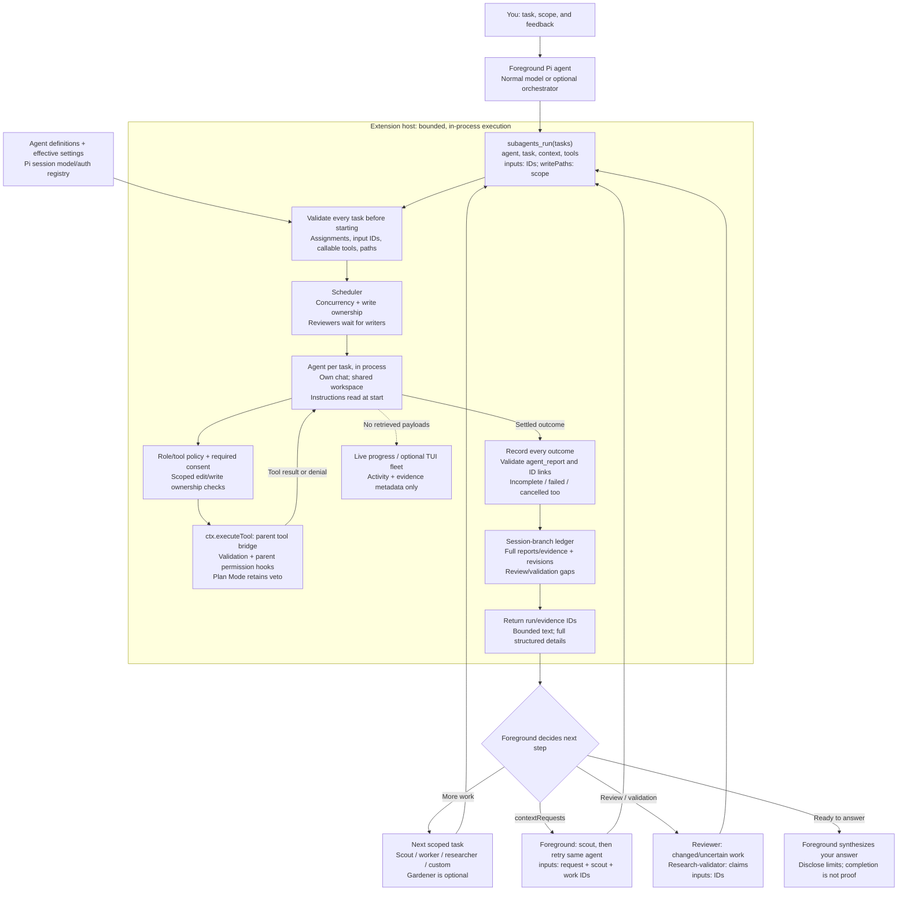

# pi-openai-subagents

OpenAI-first specialist agents for Pi, running fresh in-memory conversations through Pi's public
`Agent` API. Your normal foreground model decides when to delegate; orchestrator mode is an
optional prompt/loadout, not a scripted workflow engine. Six bundled specialists and custom agent
definitions are supported.

Children run **in process, in the same workspace**, not in containers or worktrees. They cannot
delegate recursively, activate tools or change session settings. Tool policies and write-path
ownership are trust/scheduling boundaries, **not an OS sandbox**.

## Architecture and workflow

The foreground owns every handoff. The extension validates and executes each requested batch; it
does not choose a pipeline or let children launch other children. Read the main path from top to
bottom; the loops at the bottom are **new foreground-issued calls**, not automatic retries.



Solid arrows show execution and report flow; the dotted arrow is display-only progress. Each child
receives its task, explicit context, and bounded copies of selected `inputs`—not the whole parent
conversation or another child's transcript. Invalid batch setup starts no children; missing reports
or context requests leave work incomplete. Cancellation and limits do not restart it. Gardener and
follow-up stages are foreground decisions, never a mandatory automatic chain.

## Setup

Requires Node >=22.19 and Pi host APIs; workspace development targets Pi 1.5.0. Follow
[repository installation](../README.md), then `/reload` or restart Pi. Do not also register a child
directory as a package. For a one-session load after root installation:

```sh
pi --no-extensions --extension /path/to/pi-openai-subagents/index.ts
```

Sign in with `/login openai`, or explicitly select a managed account with `/openai-accounts` from
[OpenAI Multi](../pi-openai-multi/README.md). Models/authentication come from Pi's session
registry; this extension adds no credential store or global model-setting changes. Other providers
require explicit role assignments. Web research additionally needs callable `openai_search` and
`web_action` from [pi-openai-web](../pi-openai-web/README.md); tools are never enabled
automatically.

## Everyday use

```text
/subagents on
/subagents status
/subagents list
/subagents models
/subagents tools researcher
/subagents off
```

Converse and steer normally while enabled. Enabling selects the orchestrator's assigned
model/thinking; disabling restores the previous selection unless you manually changed it. While
enabled, `/model` and `/thinking` edit session-local orchestrator assignments. Delegation also
works outside orchestrator mode, but without automatic quality reminders.

Assign roles with `/subagents model scout openai/<installed-model-id>` or `/subagents thinking
reviewer high`. Changes require an idle session and are session-local unless saved. See
[commands and persistence](docs/reference.md#commands-and-persistence) before using `--save`,
custom tool policies or project settings.

| Specialist         | Use                                                               |
| ------------------ | ----------------------------------------------------------------- |
| scout              | Map code, interfaces, conventions and constraints without edits.  |
| worker             | Implement scoped changes and verify them.                         |
| gardener           | Optional behavior-preserving cleanup grounded in project style.   |
| reviewer           | Independently inspect changes and run checks; do not fix sources. |
| researcher         | Research material claims with sources, dates and uncertainty.     |
| research-validator | Independently validate supplied research with its own search.     |

A useful request to the foreground:

> Have a scout inspect the API conventions, then a worker add input validation only in `src/api/`.
> If cleanup is useful, run Gardener after the worker settles. Give an independent reviewer both
> changed run IDs and report the checks actually performed.

The foreground calls `subagents_run`, sequences stages, and passes prior run/evidence IDs through
`inputs`; children do not share an implicit transcript. Gardener is not automatic and defaults to
high reasoning. If conventions are missing, it stops before editing and reports `contextRequests`:
the foreground coordinates a scoped scout and a fresh retry, or discloses the limitation. See the
[Gardener handoff](docs/reference.md#gardener-and-context-requests).

## Limits and result handling

- Defaults: 8 tasks/batch, 4 concurrent children, 24 model turns and 10 minutes/task. Limits and
  cancellation do not automatically restart potentially mutating work. There are no background
  jobs, commits, installations, rollback or separate child artifacts.
- Parallel writers need explicit, disjoint workspace-relative `writePaths`. Shell tools, shared
  builds, lockfiles and generated files can still conflict. Reviewers wait for pending writers;
  scouts can see work in progress. Sequence calls when a stable snapshot matters.
- Unknown tools require approval and fail closed without a dialog-capable UI. Parent permissions
  and Plan Mode retain their veto, including nested calls. Reviewer shell checks can write
  artifacts or execute project code despite the no-fixes instruction.
- Changed/uncertain writers need independent run-linked review; research needs independent
  validation. Orchestrator mode requests at most one continuation for quality gaps, then warns.
  Neither a completed run nor a tool-reported success is a filesystem or truth certificate.
- Children must finish with `agent_report`. Missing reports and context requests are incomplete.
  Live progress carries evidence metadata, not retrieved payloads; child input and text previews
  are bounded. Full reports/evidence remain in final result details, not persisted transcripts.

## Reference and maintenance

[The reference](docs/reference.md) covers delegation/report schemas, role ceilings and consent,
settings/definitions, review freshness, evidence/projection bounds, execution paths, live
rendering, troubleshooting and offline/manual verification. Start there when changing agent
behavior.

Shared UI infrastructure is documented in [the TUI guide](../docs/tui.md); fleet state, activity,
agent cards and execution remain local. See also [workspace development](../docs/development.md).
